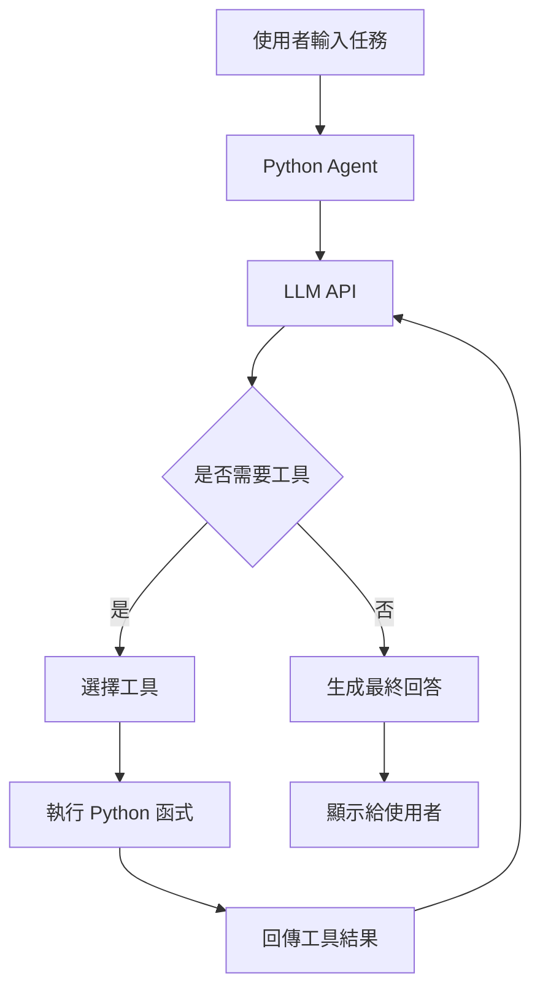

# 第12週：從 LLM API 到 AI Agent

## 一、基本資料

- 課程：現代軟體工程
- 姓名：禚鎮龍
- 學號：111410567
- 週次：第12週
- 開發工具：Visual Studio Code
- 程式語言：Python 3.14.7

## 二、作業目標

透過 AI 對話、程式實作及學習紀錄，了解如何從基本的 LLM 問答功能，逐步建立具有工具呼叫能力的 AI Agent。

本次作業採用循序漸進的方式，從模擬語言模型、API 呼叫、工具開發、Agent 建構，到最後的單元測試。

## 三、使用技術

| 技術 | 用途 |
|---|---|
| Python | 主要程式語言 |
| Google Gemini API | 大型語言模型服務 |
| Google GenAI SDK | 呼叫 Gemini API |
| urllib | 發送 HTTP 請求 |
| JSON | API 資料解析 |
| datetime | 取得日期與時間 |
| re | 正規表示式與數字擷取 |
| unittest | 自動化單元測試 |
| GitHub | 程式碼版本管理 |

## 四、LLM、API 與 Agent 的差別

### 4.1 LLM（大型語言模型）

LLM 是 Large Language Model 的縮寫，主要功能是理解自然語言、生成文字、回答問題及協助使用者完成各種文字任務。

### 4.2 API（應用程式介面）

API 是 Application Programming Interface 的縮寫，讓不同程式或系統能夠交換資料。

透過 LLM API，Python 程式可以將使用者的問題傳送給語言模型，並取得模型產生的回答。

### 4.3 Agent（AI 代理程式）

Agent 是能夠根據使用者目標進行判斷、選擇工具、執行任務及整理結果的系統。

相較於一般 LLM 問答，Agent 可以結合外部工具執行實際操作。

## 五、專案檔案結構

    week12-llm-agent/
    ├── 01_basic_llm.py
    ├── 02_basic_api.py
    ├── 03_llm_api.py
    ├── 04_tools.py
    ├── 05_basic_agent.py
    ├── 06_llm_agent.py
    ├── 07_test_tools.py
    └── README.md

## 六、程式功能介紹

### 6.1 基本 LLM 模擬

檔案：01_basic_llm.py

使用 Python 條件判斷模擬 AI 問答，了解 Prompt 與 Response 的基本概念。

此程式為規則式問答，並非真正的大型語言模型。

### 6.2 基本 API 呼叫

檔案：02_basic_api.py

透過 urllib 呼叫公開測試 API，取得 JSON 資料並解析內容。

學習 HTTP Request、Response 及 JSON 資料處理方式。

### 6.3 LLM API 串接

檔案：03_llm_api.py

使用 Google GenAI SDK 串接 Gemini API，將使用者輸入傳送至語言模型。

使用 getpass 安全輸入 API Key，避免將金鑰直接寫入程式碼。

### 6.4 Agent 工具開發

檔案：04_tools.py

建立三種工具：

- add：加法計算。
- multiply：乘法計算。
- get_current_time：取得目前日期與時間。

### 6.5 離線 Agent

檔案：05_basic_agent.py

透過關鍵字及正規表示式分析使用者輸入，自動選擇對應工具並回傳結果。

此版本不需要 API Key 或網路即可執行，但仍屬於規則式 Agent 原型。

### 6.6 LLM Agent

檔案：06_llm_agent.py

將 Python 工具提供給 Gemini 模型，透過 Function Calling 機制，讓模型判斷需要使用的工具。

設計上不再依賴固定的關鍵字選擇工具，而是由 LLM 根據使用者任務進行判斷。

### 6.7 單元測試

檔案：07_test_tools.py

使用 Python 內建的 unittest 框架，測試加法、乘法及時間格式等功能。

## 七、Agent 系統架構



以上為 LLM Agent 的設計流程。

## 八、安裝與執行方式

### 安裝套件

```bash
python -m pip install google-genai
```

### 執行基本 LLM 模擬

```bash
python 01_basic_llm.py
```

### 執行 API 測試

```bash
python 02_basic_api.py
```

### 執行 LLM API

```bash
python 03_llm_api.py
```

### 執行工具測試

```bash
python 04_tools.py
```

### 執行離線 Agent

```bash
python 05_basic_agent.py
```

### 執行 LLM Agent

```bash
python 06_llm_agent.py
```

### 執行單元測試

```bash
python 07_test_tools.py
```

以上指令須在專案資料夾內執行。

LLM API 與 LLM Agent 需要有效的 Gemini API Key。

## 九、功能測試結果

| 測試項目 | 測試結果 |
|---|---|
| 基本 LLM 模擬 | 通過 |
| 公開 API 呼叫 | 通過 |
| 加法工具 | 通過 |
| 乘法工具 | 通過 |
| 時間查詢工具 | 通過 |
| 離線 Agent | 通過 |
| LLM API | 尚未通過 |
| LLM Agent | 已撰寫，尚未進行連線測試 |
| 單元測試 | 7 項通過 |

### 單元測試結果

| 測試項目 | 結果 |
|---|---|
| 正數加法 | PASS |
| 負數加法 | PASS |
| 零值加法 | PASS |
| 正數乘法 | PASS |
| 負數乘法 | PASS |
| 零值乘法 | PASS |
| 日期時間格式 | PASS |

## 十、開發過程遇到的問題

### 問題一：404 NOT_FOUND

原先使用 gemini-2.5-flash 模型，但 API 回傳該模型已不再開放給新使用者。

解決方式：

依照 API 回傳的建議，將模型修改為 gemini-3.8-flash。

### 問題二：503 UNAVAILABLE

修改模型後，API 回傳伺服器使用需求過高的錯誤訊息。

重新測試後仍然出現相同問題。

處理方式：

先保留 LLM API 與 LLM Agent 程式碼，改以離線 Agent 完成工具選擇及執行功能。

目前尚未成功取得 Gemini 模型的回答，因此不將 LLM API 與 LLM Agent 標記為測試通過。

## 十一、AI 輔助學習過程

本次作業透過 ChatGPT 進行循序漸進的學習與程式開發。

學習流程：

1. 了解 LLM、API 與 Agent 的基本概念。
2. 使用 Python 模擬 LLM 問答。
3. 實作 HTTP API 呼叫。
4. 安裝 Google GenAI SDK。
5. 嘗試串接真正的 LLM API。
6. 建立 Agent 所需的工具。
7. 實作離線 Agent。
8. 撰寫具有 Function Calling 的 LLM Agent。
9. 進行工具單元測試。
10. 整理學習紀錄與開發成果。

## 十二、學習心得

透過本次作業，我了解到一般語言模型與 AI Agent 的差異。

一般 LLM 主要負責理解及生成文字，而 Agent 可以結合外部工具，進一步執行計算、查詢等實際任務。

在開發過程中，我也學習到如何使用 Python 呼叫 API、解析 JSON 資料、建立工具函式，以及透過單元測試驗證程式功能。

雖然 Gemini API 因模型版本及伺服器問題，尚未成功完成線上問答測試，但透過離線 Agent 的實作，仍然能夠理解任務判斷、工具選擇、工具執行與結果回傳的基本流程。

未來可以加入對話記憶、多步驟任務、自動重試及更多外部工具，使 Agent 具備更完整的功能。

## 十三、參考資源

- Google AI Studio：https://aistudio.google.com/
- Gemini API：https://ai.google.dev/
- Python：https://www.python.org/
- JSONPlaceholder：https://jsonplaceholder.typicode.com/
- ChatGPT：https://chatgpt.com/

## 十四、結論

本次作業完成了從基本 LLM 模擬、API 呼叫、工具開發、離線 Agent 到 LLM Agent 程式架構的學習與實作。

本地工具與離線 Agent 已完成測試，LLM API 與 LLM Agent 的線上功能則保留待後續驗證。

透過 AI 輔助學習與實際程式開發，逐步理解了從 LLM API 到 AI Agent 的建構方式。
