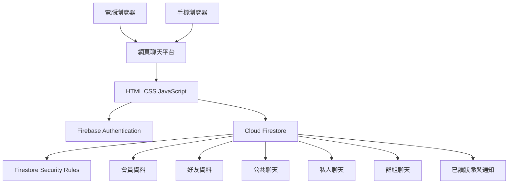

# 即時聊天與社群平台（Realtime Chat & Community Platform）

## 專案基本資料

- 課程名稱：現代軟體工程
- 學校：國立金門大學
- 科系：資訊工程學系
- 姓名：禚鎮龍
- 學號：111410567

---

## 一、專案介紹

本專案為《現代軟體工程》課程實作作品，目標是建立一個具有即時通訊與社群互動功能的網頁聊天平台。

系統包含會員註冊與登入、公共聊天、好友管理、私人聊天、群組管理、訊息已讀狀態及即時通知等功能。

本專案最初使用 LocalStorage 與 SessionStorage 進行資料管理，後續升級為 Firebase 雲端架構，透過 Firebase Authentication 進行會員身分驗證，並使用 Cloud Firestore 儲存聊天資料及實現即時同步。

使用者不需要另外安裝應用程式，即可透過網頁瀏覽器使用聊天平台。

---

## 二、使用技術

| 技術 | 用途 |
|---|---|
| HTML5 | 網頁結構 |
| CSS3 | 網頁介面與排版 |
| JavaScript | 聊天功能、事件處理與模組整合 |
| Firebase Authentication | 會員註冊、登入與身分驗證 |
| Cloud Firestore | 雲端資料儲存與即時同步 |
| Firestore Security Rules | 資料存取權限管理 |
| SessionStorage | 輔助管理登入工作階段 |
| Firebase SDK | 前端與 Firebase 服務整合 |
| Git | 程式碼版本控制 |
| GitHub | 專案原始碼管理 |
| Cloudflare Pages | 網站部署 |
| Playwright | E2E 自動化測試（規劃中） |
| Visual Studio Code | 程式開發環境 |

---

## 三、系統架構



系統採用前端網頁搭配 Firebase 雲端服務的架構，不需要自行架設傳統後端伺服器。

透過 Firestore 即時監聽機制（onSnapshot），當雲端資料發生變化時，網站可以自動更新對應的聊天內容。

---

## 四、主要功能

### 1. 會員系統

- 會員註冊
- 會員登入
- 登出功能
- Firebase 身分驗證
- 登入狀態管理
- 帳號資料驗證
- 雲端會員資料儲存

### 2. 公共聊天頻道

平台提供三個公共聊天頻道：

- 💬 一般聊天
- 💻 程式討論
- 🎮 遊戲交流

功能說明：

- 不同會員可以在相同頻道傳送訊息。
- 各頻道具有獨立聊天紀錄。
- 使用者可以自由切換聊天頻道。
- 聊天訊息儲存在 Cloud Firestore。
- 透過 Firebase 實現即時訊息同步。
- 重新整理網站後仍可讀取雲端聊天紀錄。

### 3. 好友系統

- 搜尋會員
- 發送好友邀請
- 接受好友邀請
- 拒絕好友邀請
- 移除好友
- 好友列表管理
- 防止使用者加入自己
- 找不到會員時顯示提示
- 好友資料即時同步

### 4. 私人聊天

- 好友之間傳送私人訊息
- 即時接收私人訊息
- 顯示歷史聊天紀錄
- 訊息時間顯示
- Enter 鍵傳送訊息
- 訊息已讀與未讀狀態
- 未讀訊息數量顯示
- 私人聊天資料雲端儲存
- 私人聊天存取權限限制

### 5. 群組聊天

- 建立群組
- 邀請好友加入群組
- 群組成員共同聊天
- 群組訊息即時同步
- 顯示群組成員
- 顯示群組聊天紀錄
- 成員離開群組
- 群組建立者解散群組
- 群組成員權限管理
- 群組資料雲端儲存

### 6. 訊息已讀系統

- 私人訊息已讀狀態
- 私人訊息未讀狀態
- 未讀訊息數量提示
- 開啟私人聊天室後更新已讀狀態
- 背景分頁不直接標記已讀
- 已讀紀錄儲存在雲端
- 重新登入後保留已讀紀錄

### 7. 即時通知系統

通知類型：

- 👤 好友邀請通知
- 💬 私人訊息通知
- 👥 群組邀請通知

通知管理功能：

- 即時接收通知
- 顯示未讀通知數量
- 單筆通知標記已讀
- 全部通知標記已讀
- 刪除通知
- 清空通知
- 通知資料雲端儲存
- 重新登入後保留尚未刪除的通知

### 8. 社群快捷功能

| 圖示 | 功能 |
|---|---|
| 💬 | 切換一般聊天 |
| 💻 | 切換程式討論 |
| 🎮 | 切換遊戲交流 |
| ➕ | 前往建立群組輸入區域 |

---

## 五、Firebase 雲端資料庫

本專案使用 Cloud Firestore 管理系統資料。

### 資料庫主要結構

```text
Cloud Firestore
├── users
│   └── username
│       └── notifications
│           └── notificationId
├── friendships
│   └── friendshipId
├── publicChats
│   └── channelId
│       └── messages
│           └── messageId
├── privateChats
│   └── chatId
│       ├── messages
│       │   └── messageId
│       └── readStatus
│           └── username
└── groups
    └── groupId
        └── messages
            └── messageId
```

### 資料集合說明

| 資料集合 | 用途 |
|---|---|
| users | 會員識別資料 |
| friendships | 好友關係與邀請狀態 |
| publicChats | 公共聊天室訊息 |
| privateChats | 私人聊天訊息 |
| readStatus | 私人訊息已讀紀錄 |
| groups | 群組資料與聊天訊息 |
| notifications | 個人通知資料 |

### 雲端同步機制

- 使用 Firebase Authentication 確認會員身分。
- 使用 Cloud Firestore 儲存系統資料。
- 使用 onSnapshot 監聽資料變化。
- 使用 serverTimestamp 記錄伺服器時間。
- 使用 Transaction 處理部分需要一致性的資料操作。
- 使用 Write Batch 同時處理私人訊息與相關通知。

---

## 六、資料安全與權限管理

本專案透過 Firebase Authentication 與 Firestore Security Rules 管理資料存取權限。

主要安全機制：

- 未登入使用者不得存取聊天資料。
- 會員密碼由 Firebase Authentication 管理。
- 使用者不得冒用其他會員身分傳送訊息。
- 私人聊天僅限具有有效好友關係的雙方存取。
- 群組聊天僅限有效群組成員存取。
- 群組解散功能僅限群組建立者操作。
- 使用者僅能更新自己的已讀紀錄。
- 個人通知僅限通知擁有者讀取與管理。
- 限制聊天訊息長度。
- 限制群組名稱長度及成員數量。

目前已完成基本權限驗證，但尚未進行完整的資安攻擊與壓力測試，因此仍以課程展示用途為主。

---

## 七、專案檔案結構

```text
即時聊天/
├── index.html
├── auth.html
├── style.css
├── script.js
├── firebase.js
├── auth.js
├── friends.js
├── public-chat.js
├── private-chat.js
├── groups.js
├── read-status.js
├── notifications.js
└── README.md
```

### 各檔案用途

| 檔案 | 用途 |
|---|---|
| index.html | 主要聊天介面 |
| auth.html | 會員登入與註冊介面 |
| style.css | 網站樣式與排版 |
| script.js | 聊天主程式與功能整合 |
| firebase.js | Firebase 初始化與服務設定 |
| auth.js | 會員驗證與登入管理 |
| friends.js | 好友管理與即時同步 |
| public-chat.js | 公共聊天室功能 |
| private-chat.js | 私人聊天功能 |
| groups.js | 群組管理與聊天功能 |
| read-status.js | 訊息已讀與未讀狀態 |
| notifications.js | 即時通知與通知管理 |
| README.md | 專案說明文件 |

---

## 八、使用方式

### 網站使用流程

1. 開啟聊天平台網站。
2. 註冊新帳號或登入既有帳號。
3. 進入聊天主頁。
4. 選擇一般聊天、程式討論或遊戲交流。
5. 輸入訊息並送出。
6. 搜尋其他會員並發送好友邀請。
7. 好友接受邀請後即可進行私人聊天。
8. 建立群組並邀請好友加入。
9. 透過通知中心查看相關通知。
10. 使用完畢後可以登出帳號。

### 本機開發方式

1. 下載或 Clone GitHub 專案。
2. 使用 Visual Studio Code 開啟專案資料夾。
3. 使用 Live Server 啟動網頁。
4. 開啟登入頁面。
5. 註冊或登入帳號進行測試。

本專案使用 Firebase CDN 模組，不需要透過 npm 安裝 Firebase 套件即可執行目前的網頁功能。

---

## 九、功能測試

本專案開發期間使用不同會員帳號進行手動功能測試。

| 測試項目 | 測試結果 |
|---|---|
| 會員註冊 | 通過 |
| 會員登入 | 通過 |
| 會員登出 | 通過 |
| 會員雲端資料儲存 | 通過 |
| 好友搜尋 | 通過 |
| 好友邀請 | 通過 |
| 接受好友邀請 | 通過 |
| 私人聊天 | 通過 |
| 私人訊息即時同步 | 通過 |
| 群組建立 | 通過 |
| 群組邀請 | 通過 |
| 群組訊息傳送 | 通過 |
| 離開群組 | 通過 |
| 解散群組 | 通過 |
| 公共一般聊天 | 通過 |
| 公共程式討論 | 通過 |
| 公共遊戲交流 | 通過 |
| 公共聊天即時同步 | 通過 |
| 私人訊息已讀狀態 | 通過 |
| 未讀訊息數量顯示 | 通過 |
| 已讀紀錄雲端保存 | 通過 |
| 好友邀請通知 | 通過 |
| 私人訊息通知 | 通過 |
| 群組邀請通知 | 通過 |
| 通知標記已讀 | 通過 |
| 全部通知標記已讀 | 通過 |
| 清空通知 | 通過 |
| 通知雲端保存 | 通過 |
| 基本資料存取權限驗證 | 通過 |
| 移除舊版示範資料 | 完成 |
| 手機與電腦跨裝置測試 | 待正式部署後驗證 |
| Playwright E2E 自動化測試 | 尚未執行 |

### 測試帳號

雲端功能測試使用兩個不同會員帳號，分別進行好友邀請、私人聊天、公共聊天、群組聊天、已讀狀態與通知功能測試。

為保護帳號安全，README 不公開測試帳號密碼。

---

## 十、自動化測試規劃

本專案後續預計加入以下三種軟體測試方式。

### 1. 單元測試（Unit Testing）

規劃測試：

- 帳號格式驗證
- 訊息內容驗證
- 好友識別碼產生
- 私人聊天室識別碼產生
- 未讀訊息數量計算

### 2. 系統測試（System Testing）

規劃測試：

- Firebase 會員驗證
- 雲端資料讀取與寫入
- 好友資料管理
- 聊天訊息傳送
- 群組權限管理
- 通知資料管理
- Firestore Security Rules

### 3. E2E 自動化測試（End-to-End Testing）

預計使用 Playwright 進行端對端測試。

規劃項目：

1. 會員註冊與登入測試。
2. 公共聊天訊息傳送測試。
3. 公共頻道切換測試。
4. 不同會員即時聊天測試。
5. 好友邀請與接受測試。
6. 私人聊天測試。
7. 群組建立與聊天測試。
8. 訊息已讀狀態測試。
9. 通知功能測試。
10. 登出功能測試。

目前以上自動化測試仍屬規劃階段，尚未正式執行。

---

## 十一、專案開發歷程

| 階段 | 開發內容 | 狀態 |
|---|---|---|
| 第一階段 | 建立基本聊天介面 | 完成 |
| 第二階段 | 會員註冊與登入 | 完成 |
| 第三階段 | 好友管理系統 | 完成 |
| 第四階段 | 私人聊天功能 | 完成 |
| 第五階段 | 群組聊天與管理 | 完成 |
| 第六階段 | 公共聊天頻道 | 完成 |
| 第七階段 | Firebase 雲端服務整合 | 完成 |
| 第八階段 | 雲端會員驗證 | 完成 |
| 第九階段 | 好友資料雲端化 | 完成 |
| 第十階段 | 私人聊天雲端化 | 完成 |
| 第十一階段 | 公共聊天雲端化 | 完成 |
| 第十二階段 | 群組聊天雲端化 | 完成 |
| 第十三階段 | 訊息已讀系統 | 完成 |
| 第十四階段 | 即時通知系統 | 完成 |
| 第十五階段 | 基本資料安全與權限管理 | 完成 |
| 第十六階段 | 舊版程式碼清理 | 完成 |
| 第十七階段 | 最新版本正式部署 | 進行中 |
| 第十八階段 | 跨裝置正式測試 | 待完成 |
| 第十九階段 | 自動化測試 | 規劃中 |

---

## 十二、目前系統限制

雖然本專案已完成 Firebase 雲端架構整合，但仍有以下限制：

- Firebase 免費方案具有使用量限制。
- 尚未進行大量使用者同時上線的壓力測試。
- 尚未完成完整的自動化測試。
- 尚未提供圖片與檔案傳送功能。
- 尚未提供語音與視訊通話功能。
- 尚未建立真正的即時在線成員統計。
- 尚未完成完整資安攻擊測試。
- 跨裝置功能仍需在正式部署環境進行驗證。

本專案目前主要作為課程實作與功能展示使用。

---

## 十三、未來改進方向

- 加入完整單元測試。
- 加入系統測試與測試報告。
- 加入 Playwright E2E 自動化測試。
- 改善手機版響應式介面。
- 加入會員頭像與個人資料設定。
- 加入圖片與檔案傳送功能。
- 加入會員在線狀態。
- 加入訊息搜尋功能。
- 加入訊息分頁載入機制。
- 優化 Firebase 資料讀取次數。
- 強化系統安全性與權限驗證。
- 改善大量使用者同時使用時的效能。

---

## 十四、專案成果與心得

透過本次專案，我實際練習了網頁前端開發、JavaScript 事件處理、會員管理、資料庫設計、雲端服務整合、版本控制及網站部署。

開發初期使用 LocalStorage 儲存會員與聊天資料，但在測試過程中發現，本機儲存方式無法滿足不同裝置之間的即時通訊需求。

因此，我將原本的本機儲存架構逐步升級為 Firebase 雲端架構，並重新設計會員驗證、好友管理、公共聊天、私人聊天、群組聊天、已讀狀態及通知系統。

在整合 Firebase 的過程中，我學習到雲端資料庫的即時監聽機制、非同步程式處理、資料一致性及資料存取權限的重要性。

此外，我也透過不同會員帳號反覆進行功能測試，確認各項功能是否正常運作，並逐步修正開發過程中發現的問題。

本次專案讓我更加了解現代軟體工程不只是撰寫程式碼，也包含需求分析、系統設計、功能開發、測試驗證、版本管理及正式部署等完整流程。

未來希望能加入完整的自動化測試，並持續改善系統效能、安全性與使用者體驗，使聊天平台更加完整。

---

## 十五、專案連結

### GitHub 原始碼

https://github.com/s111410567-web/_se/tree/main/即時聊天

### Cloudflare Pages 網站展示

https://se-e04.pages.dev/

---

## 十六、專案狀態

- 核心聊天功能：已完成
- Firebase 雲端整合：已完成
- 會員身分驗證：已完成
- 好友管理系統：已完成
- 公共聊天系統：已完成
- 私人聊天系統：已完成
- 群組聊天系統：已完成
- 訊息已讀系統：已完成
- 即時通知系統：已完成
- 手動功能測試：已完成目前規劃的基本測試
- 最新版本正式部署：進行中
- 跨裝置正式測試：待完成
- 自動化測試：規劃中

---

本專案為國立金門大學資訊工程學系《現代軟體工程》課程實作作品。
